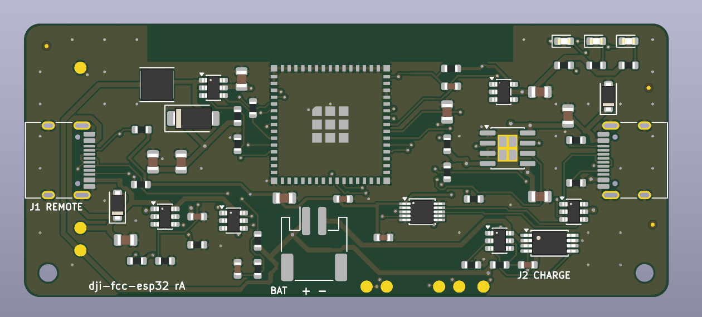

<h1 align="center">dji-fcc-esp32</h1>

<p align="center">
  <b>A pocket dongle that switches a DJI N1 remote to FCC mode, instead of a phone and an app.</b><br>
  Plug it in, it patches over USB, shows the result on an LED and goes back to sleep.
</p>

<p align="center">
  <a href="https://github.com/nikolaus018/dji-fcc-esp32/actions/workflows/ci.yml"></a>
  <a href="LICENSE"></a>
  
  
</p>

<p align="center">
  
</p>

## What is in here

- **Firmware** (ESP-IDF): USB host stack for the remote's CDC-ACM interface, with Espressif's USB component patched to cope with the remote's
  512-byte bulk packets on a full-speed link.
- **Hardware** ([`hardware/`](hardware/README.md)): a complete KiCad design for a battery-powered dongle, generated from one Python source of truth:
  schematic, autorouted 2-layer PCB, gerbers, JLCPCB BOM and placement, STEP model. 0 DRC errors.
- **Web flasher** ([live](https://nikolaus018.github.io/dji-fcc-esp32/), source in [`webflasher/`](webflasher/)): flash either build from Chrome or Edge over Web Serial. Built and deployed by CI on every push.

The two packets come from [DJI-FCC-HACK](https://github.com/M4TH1EU/DJI-FCC-HACK) (credit to galbb on MavicPilots);
this project replaces its Android app.

## Two ways to run it

* **Dev board** (any ESP32-S3 with a native USB port): default build, instructions below.
* **Custom PCB** (battery powered dongle, charge over USB-C, sleeps between uses): see [`hardware/`](hardware/README.md).
  Build the firmware for it with
  ```bash
  idf.py -B build_custom -DSDKCONFIG=sdkconfig.custom -DSDKCONFIG_DEFAULTS=sdkconfig.board_custom -DIDF_TARGET=esp32s3 build
  ```

## Use (dev board)
1. Flash through the **COM** port: `idf.py -p <port> flash`
2. Close the **USB-OTG** solder pad on the board bottom so it can power the remote's port.
3. Power on the drone and remote, wait until connected. The phone must **not** be connected to the remote while patching.
4. Plug the board's **USB** port into the remote's **bottom** port.
5. LED: blue = waiting, yellow = sending, green = sent, red = error.
6. Unplug the board and connect your phone to the **top** port.

The patch must be repeated **every time** you power on the drone and remote.

FCC power is only legal in the US; power cycle the drone and remote to return to CE.

## Flashing the custom PCB
Plug **J2** into your computer and run `idf.py -B build_custom ... -p <port> flash` (port is the ESP's built-in USB-Serial-JTAG). Details in
[`hardware/README.md`](hardware/README.md#flashing-and-updates).

## Notes
- The remote reports 512-byte bulk packets on a full-speed link. `components/espressif__usb` is a copy of
  Espressif's USB host component with the MPS check in `hcd_dwc.c` relaxed, and `main/dji.c` sizes the
  non-periodic TX FIFO for it. Both are required.
- The CDC serial function is interface 2; interfaces 0/1 are DJI-proprietary.
- The LED code drives GPIO48 and GPIO38 (DevKitC-1 v1.0 / v1.1).
- `main/board.h` is the board abstraction (`board_devkit.c` / `board_custom.c`); `main/dji.c` holds the patch logic.
- The dev-board build was tested on a real remote; the custom-PCB firmware compiles but, like the hardware itself, has never run on a real board (see `hardware/README.md`).

## License
MIT for this project's own code (see `LICENSE`). `components/espressif__usb` is Apache-2.0 (Espressif), see its own `LICENSE`.
