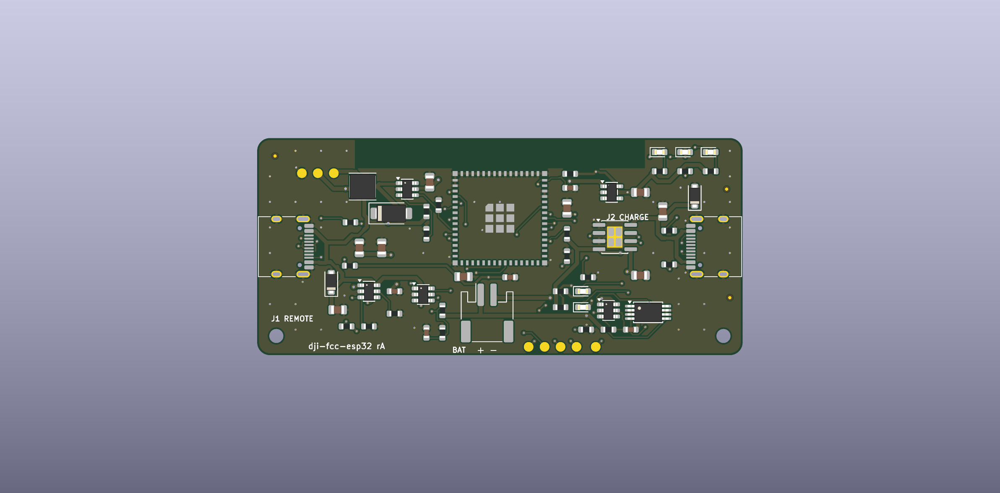

# dji-fcc-esp32 hardware (rev A)

A small battery-powered dongle that replaces the Android phone in the DJI N1 "FCC patch" workflow:
plug it into the remote's **bottom** USB-C port, it powers the port, sends the patch, shows the result on an LED
and goes back to sleep. Charge it over USB-C.



**Status: rev A, ready to order a prototype batch. Not yet built or tested on real hardware.**
Everything below was checked by KiCad ERC/DRC and by cross-checking datasheets; nothing has been powered up.
See [Before you call it production](#before-you-call-it-production).

## What it does

```
 J2 USB-C (charge only)        J1 USB-C (to the remote's bottom port)
   │ 5 V                          ▲ 5 V, ~540 mA limit      D+/D-/CC
   ▼                              │                          │
 TP4056 charger ──► VBAT ──► MT3608 boost ──► TPS2553 switch ─┤
 (255 mA)            │  ▲        (5.0 V)        (EN from ESP)  │
                     │  └── DW01A + FS8205A protection        │
                     ▼                                        ▼
                  AP2112K 3.3 V ──► ESP32-S3-MINI-1-N8 ◄── USBLC6 ESD
                                      │ ADC: CC1/CC2 (attach), VBAT
                                      └ RGB status LED, UART pads
```

Behaviour (firmware `main/`, built with `CONFIG_DJI_BOARD_CUSTOM`):

1. Deep sleep (~85 µA). The two CC pins of J1 idle high (33 kΩ pull-ups to 3V3).
2. The remote's 5.1 kΩ Rd pulls a CC pin low on plug-in → ESP wakes (EXT1).
3. Battery check (< 3.3 V → red blinks, sleep). Blue LED. Boost on, switch on → remote gets VBUS and enumerates.
4. Patch is sent over the remote's CDC-ACM interface. Yellow while sending, **green = success, red = failure**.
5. Port power off, wait for unplug, deep sleep. Repeat the plug-in after every power-on of the drone/remote.

LED colours: blue = powering remote, yellow = sending, green = patched, red = error / low battery.
Two small LEDs near J2: red = charging, green = charge complete.

## Files

| Path | What |
|---|---|
| `design.py` | Single source of truth: every part, value, footprint and net. |
| `gen_sch.py` → `dji-fcc.kicad_sch` | Generates the schematic (nets as global labels, one sheet). |
| `gen_pcb.py`, `placement.json`, `route.py`, `tools/route.sh` | Placement → Freerouting → import → ground pours, stitching vias → DRC. |
| `dji-fcc.kicad_pcb` / `.kicad_pro` | The board. Open in KiCad 9/10. |
| `lib/dji_parts.kicad_sym` | Custom symbols (FS8205A, TPS2553). |
| `fab/` | `dji-fcc-gerbers.zip`, `bom_jlcpcb.csv`, `cpl_jlcpcb.csv`, `bom_full.csv`, `dji-fcc.step`, raw gerbers/drill. |
| `docs/` | `schematic.pdf`, `pcb_top.pdf`, `pcb_bottom.pdf`, renders. |

Regenerate everything (needs KiCad, `uv`, Java and Freerouting, see `tools/env.sh`):

```bash
cd hardware
uv run --with kiutils python gen_sch.py     # schematic + pin map
PASSES=100 tools/route.sh                   # placement, autoroute (retries), pours, DRC
tools/fab.sh                                # gerbers, drill, BOM, CPL, PDFs, STEP
```

Edit parts/nets in `design.py` and positions in `placement.json`; do not hand-edit the generated KiCad files
unless you stop using the generators.

## Board

* 76 × 34 mm, 1.6 mm, 2-layer, all parts on top (single-sided SMT assembly), 2 mm corner radius.
* Net classes: power 0.6 mm (routed down to 0.4–0.45 mm at pads), signals 0.2 mm, ≥ 0.1 mm minimum, vias 0.6/0.3 (0.8/0.4 power).
* Ground pour on both layers with stitching vias; DRC: 0 errors, 0 unconnected. Schematic parity checked.
* Antenna keepout of the ESP module sits at the top edge (the radio is unused, but nothing is placed there).

### Enclosure interface

| Item | Position (mm, origin top-left, +y down) |
|---|---|
| J1 USB-C (to remote) | mouth flush with left edge, centre y = 17, shell 8.94 wide × 3.3 high |
| J2 USB-C (charge) | mouth flush with right edge, centre y = 17 |
| Status LEDs R/G/B | (63, 2.2), (67, 2.2), (71, 2.2): light-pipe window in the top-right corner |
| Charge LEDs | (51, 24) red, (51, 26.5) green (can be left covered) |
| Mounting holes | 2 × Ø2.2 (M2) at (3, 31) and (73, 31) |
| Battery | JST-PH 2 mm at (36, 27.4); a 502040 pouch (≈ 5 × 20 × 40 mm, 400-500 mAh) fits under the board |
| Programming/test pads | bottom edge x = 42.5 … 53, y = 32.7 (EN, IO0, TX, RX, 3V3); GND/VBAT/VBUS pads top-left |
| Tallest parts | JST connector 5.5 mm, USB-C 3.3 mm, module 2.4 mm, inductor 2.0 mm |

`fab/dji-fcc.step` contains the board and component models for fitting a case. Keep metal away from the top edge
(antenna end of the module). Both USB-C ports are exposed in the default layout; a case that only exposes J1
is possible if J2 is reached through a cover or only used at the factory.

## Ordering (JLCPCB)

1. Upload `fab/dji-fcc-gerbers.zip`: 2 layers, 1.6 mm, any surface finish (HASL is fine; ENIG nicer for USB-C).
2. Enable SMT assembly, **top side**, upload `fab/bom_jlcpcb.csv` and `fab/cpl_jlcpcb.csv`.
3. In the placement viewer **check rotation of every polarised part** (U1..U7, Q1, J1..J3, D1..D8, L1).
   JLCPCB's part library often needs per-part rotation offsets (`cpl_jlcpcb.csv` uses KiCad's rotation as-is).
4. Hand-fit afterwards: battery (pre-wired JST-PH 2.0 pack, **polarity: + on pin 1, silkscreen shows + and -**).
   Many packs are wired the other way round; check with a meter before connecting.
5. Flash through the pads (below), then run the bring-up list.

`fab/bom_full.csv` lists every line with MPN and LCSC number. Numbers were looked up on jlcpcb.com on 2026-10-11:
every line resolved to a matching part except L1 (C48427 was only seen on LCSC's datasheet listing; confirm
4.7 µH / ≥ 2 A saturation). **Stock and "basic vs extended" status change, re-check before ordering.**
The DW01A pin order (OD, CS, OC, TD, VCC, GND) is the standard one but I could not open the vendor datasheet
for C2927799; compare it with the datasheet before ordering.

## Flashing

No USB data path to J2 (the S3 has one USB PHY and it belongs to J1). Program through the pads (UART0):

1. Disconnect the battery. Clip a 3.3 V USB-UART adapter to **TX, RX, GND** and supply 3.3 V from the adapter to the 3V3 pad.
2. Short **IO0** to GND, tap **EN** to GND, release EN, then release IO0 after "waiting for download".
3. `idf.py -B build_custom ... flash` (see the firmware README section).

Do not power from the 3V3 pad while the battery is connected.

## Design notes

* **Remote port:** Rp = 33 kΩ to 3V3 on both CC pins (spec: 36 kΩ ±20 % = default USB power). VBUS comes from an
  MT3608 boost (FB divider 220 k/30 k → 5.0 V) through a TPS2553 (R_ILIM 47 kΩ ≈ 540 mA, reverse-blocking, /FAULT to the ESP).
  The boost output is not isolated when disabled (battery minus a diode drop leaks to its output), the switch is what keeps the port dead.
* **Charger:** TP4056, R_PROG 4.7 kΩ → 255 mA (≈ 0.5 C for a 500 mAh cell), TEMP tied to GND (no NTC), CE tied high.
* **Protection:** DW01A + FS8205A in the battery negative leg (net `BNEG` ↔ `GND`), so the pack cannot over-discharge even
  if the firmware misbehaves. Still use a good cell; protection ICs are not a substitute.
* **LDO:** AP2112K-3.3 directly from VBAT. Below ≈ 3.55 V the rail sags (dropout), the firmware refuses to start the remote below 3.3 V.
* **Sleep current:** AP2112K 55 µA + S3 deep sleep ~7 µA + DW01A ~3 µA + dividers ~17 µA ≈ 85 µA → months of standby on 500 mAh.
* **Status LEDs** sit between VBAT and the GPIOs (sinking, GPIO low = on) so the blue LED still has headroom at 3.3 V.
* **Pins used:** IO1/IO2 CC1/CC2 (ADC1, wake), IO4 VBAT sense (ADC1), IO6 boost EN, IO7 switch EN, IO8 /FAULT, IO38 charger-VBUS sense,
  IO40/41/42 LED B/G/R, IO19/IO20 USB, TXD0/RXD0 UART pads, IO0/EN pads.

## Before you call it production

This is a prototype-ready design, not a production release. Open items, roughly in order:

1. **Build 5 boards and bring them up.** Checklist:
   - Visual / continuity: no shorts VBAT-GND, 3V3-GND, VBUS_REM-GND with the battery out.
   - Charge port: 5 V in → red LED, TP4056 BAT ≈ 4.2 V at end of charge, 255 mA max.
   - Protection: battery connected, measure VBAT at J3 vs. 3V3 pad; short-circuit test on a bench supply with current limit.
   - Boost: VBOOST = 5.0 V ± 3 % with 100 Ω load, ripple < 100 mV; `BOOST_EN` low → switch output < 0.1 V.
   - Switch: VBUS_REM = 0 V when idle, 5 V when enabled, trips at ≈ 0.5-0.6 A.
   - **J1 CC behaviour with a real remote:** confirm CC reads ≈ 0.44 V when plugged and the board wakes. If a remote variant
     does not present Rd, the wake logic needs a fallback (timer wake + VBUS probe).
   - Full patch cycle on every drone/remote you care about (README of DJI-FCC-HACK lists tested ones).
2. **Verify placement rotations** in the JLCPCB viewer and on the first assembled board.
3. **Battery:** a protected 1S LiPo with PH-2.0 lead and the polarity you expect. Mechanical retention and a label on the case.
4. **Compliance** (needed to sell it): FCC Part 15B / CE EMC for an unintentional radiator that contains a pre-certified module,
   UN38.3 transport test for the battery, RoHS paperwork. Also check the legal side of selling a product whose purpose is to switch
   a DJI remote to its FCC power profile.
5. Firmware: add a long-press/second-wake path if you want field updates (currently UART pads only), consider a boot-time
   brown-out margin test with a nearly empty cell.
